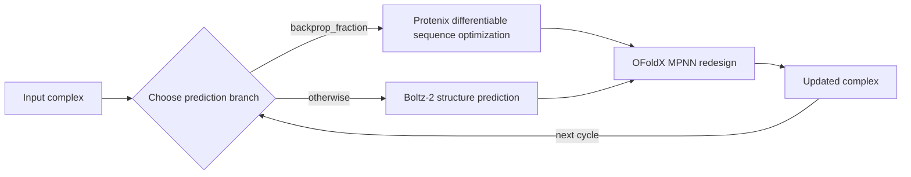

# RFOptimization

!!! tip "Iterative design"
    RFOptimization (RFO) combines gradient-guided sequence optimization, structure prediction, and sequence redesign in a repeated design cycle.

RFO is a framework for improving a protein design in the context of its structural partners. RFO owns the optimization and cycle logic. It calls Protenix, Boltz-2, ProteinMPNN, and LigandMPNN through the RFO-compatible [OFoldX integration branch](https://github.com/OTeam-AI4S/OFoldX-for-RFO/tree/rfo-integration).

The designed protein is chain **A**. Other chains are retained as partners. Each outer cycle selects the Protenix gradient branch or the Boltz-2 prediction branch, then uses OFoldX MPNN to redesign unfixed chain-A residues.

## Get started

Install RFO and the compatible OFoldX branch into the same Python 3.12+ environment. Choose a PyTorch build that matches your hardware before installing RFO.

```bash
python -m pip install -e .
python -m pip install "git+https://github.com/OTeam-AI4S/OFoldX-for-RFO.git@rfo-integration"
```

Run a small workflow with the bundled example configuration after checking the input and output paths:

```bash
rfo --config src/rfo/cycling/configs/example.yaml --total-cycles 1
```

[Installation guide](installation.md){ .md-button }
[Quickstart](quickstart.md){ .md-button }

## How a cycle works



Protenix model weights stay frozen. RFO differentiates the selected objective through OFoldX's Protenix trunk and confidence heads to update the sequence representation; diffusion sampling is outside that gradient path. Boltz-2 runs a structure-prediction step. Both branches hand off to MPNN before the next cycle.

## At a glance

| Component | Role |
| --- | --- |
| RFO cycle driver | Chooses a prediction branch, manages inputs and outputs, and repeats cycles. |
| Protenix through OFoldX | Provides the differentiable prediction path used for gradient-guided sequence optimization. |
| Boltz-2 through OFoldX | Provides the alternative structure-prediction branch. |
| ProteinMPNN or LigandMPNN through OFoldX | Redesigns unfixed chain-A residues while retaining the partner chains. |

RFO and OFoldX are separate projects but must be installed in the same Python environment. OFoldX is installed separately from its `rfo-integration` branch; RFO model weights are downloaded and cached by OFoldX.

## Learn more

- [Workflow](workflow.md): branch selection, residue fixing, and handoff behavior.
- [Configuration](configuration.md): YAML options, objectives, and model overrides.
- [Outputs](outputs.md): generated structures, cycle folders, and score records.
- [Manual workflow cases](manual_workflow_cases.md): example end-to-end runs.
- [Citation](about/citation.md) · [License](about/license.md)
